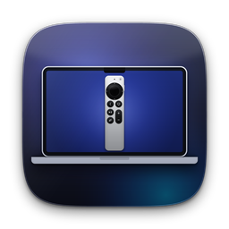

<p align="center"></p>

# ATV Remote — пульт Apple TV в строке меню macOS

[English](README.md) · **Русский**

[](https://github.com/kidwhoseeghosts/atv-remote-mac/releases)
[](https://github.com/kidwhoseeghosts/atv-remote-mac/actions/workflows/build.yml)
[](LICENSE)


Приложение живёт в строке меню (без значка в Dock) и управляет Apple TV по локальной сети.
Интерфейс повторяет Apple TV Remote из Пункта управления iPhone: большая сенсорная панель,
круглые кнопки, карточка «Сейчас играет» с обложкой, «стекло» (Liquid Glass на macOS 26+,
`.ultraThinMaterial` на более старых), пружинные анимации, тактильный отклик трекпада.

* Интерфейс — Swift / SwiftUI, цель: macOS 14+ (проверка на macOS 27 — на вашей стороне, см. «Что проверено»).
* Протоколы — библиотека [pyatv](https://pyatv.dev) 0.18.0 в виде долгоживущей Python-службы
  (`Resources/python/atvd.py`), общение по stdin/stdout, JSON Lines.
* Без платного аккаунта разработчика: ad-hoc подпись, песочница выключена.
* Универсальная сборка (Apple Silicon и Intel). Интерфейс на английском и русском — следует языку системы.

## Установка из релиза

Нужен macOS 14 или новее (Apple Silicon или Intel).

1. Скачайте `ATVRemote-<версия>.zip` со страницы [Releases](https://github.com/kidwhoseeghosts/atv-remote-mac/releases) и распакуйте.
2. Перенесите `ATVRemote.app` в `/Applications`.
3. Приложение подписано ad-hoc (без платного аккаунта разработчика), поэтому macOS пометит скачанную копию карантином. Снимите его:

   ```bash
   xattr -dr com.apple.quarantine /Applications/ATVRemote.app
   ```

   (или правый клик по приложению → **Открыть** → **Открыть**).
4. Запустите приложение — иконка появится в строке меню. При первом запуске оно предложит установить pyatv (см. ниже).

## Возможности

| | |
|---|---|
| Выбор устройства | «таблетка» сверху, поиск по mDNS, запоминание последнего устройства |
| Сенсорная панель | свайп мышью/трекпадом или прокрутка двумя пальцами → стрелки; клик → «Выбрать»; подсветка направления; опционально клик по краям = стрелки |
| Кнопки | Назад (Menu), Домой (TV), Пауза/Воспроизведение, Без звука, Громче/Тише (с автоповтором), ±10 с, Питание |
| Сейчас играет | название, подзаголовок, обложка, прогресс |
| Приложения | сетка приложений Apple TV (`app_list`) с поиском, запуск (`launch_app`) |
| Ввод текста | `keyboard.text_set` — когда на Apple TV открыто поле ввода |
| Сопряжение | PIN для Companion, AirPlay и MRP; ключи хранятся в `~/Library/Application Support/ATVRemote/pyatv.conf`, повторное подключение автоматическое |
| Горячие клавиши | глобальные (Carbon `RegisterEventHotKey`), настраиваются; стрелки/Return/Space/⌫/H/+/−/,/. работают, когда окно пульта в фокусе |
| Плавающее окно | отдельное окно с тем же пультом и кнопкой «поверх всех окон» (📌) |
| Автозапуск | `SMAppService.mainApp` (переключатель в настройках) |
| Диагностика громкости | экран с активными протоколами, прогон всех способов по очереди, выбор рабочего (см. «Диагностика громкости») |
| Локализация | английский и русский (String Catalog), язык берётся из настроек системы |
| Тёмная/светлая тема, VoiceOver | подписи и действия у всех элементов |

## Сборка из исходников

Нужны: Xcode 16+ (любая версия, которая собирает проект под macOS 14+) и [Homebrew](https://brew.sh).
Источник правды для проекта — `project.yml`; `ATVRemote.xcodeproj` и `Config/Info.plist` генерируются [XcodeGen](https://github.com/yonaskolb/XcodeGen) и в git не хранятся.

```bash
git clone https://github.com/kidwhoseeghosts/atv-remote-mac.git
cd atv-remote-mac
brew install xcodegen
xcodegen && open ATVRemote.xcodeproj
```

В Xcode: цель **ATVRemote → Signing & Capabilities** — оставьте «Sign to Run Locally» (ad-hoc) или выберите
свой Personal Team (бесплатный Apple ID). Нажмите ⌘R.

То же из терминала (сборка + установка в /Applications + запуск):

```bash
scripts/build.sh --install --open
```

Релизная сборка (universal, ad-hoc подпись) и архив:

```bash
scripts/release.sh            # → dist/ATVRemote-<версия>.zip (+ .sha256), открывает Finder на .app
UNIVERSAL=0 scripts/release.sh   # только архитектура этого Mac (быстрее)
scripts/release.sh --no-open     # не открывать Finder
```

### Если macOS не даёт открыть приложение (Gatekeeper)

Приложение подписано ad-hoc, поэтому при запуске скачанной/скопированной копии macOS может ругаться (то же, что в разделе «Установка из релиза»).
Правый клик по приложению → **Открыть** → **Открыть**, либо:

```bash
xattr -dr com.apple.quarantine /Applications/ATVRemote.app
```

### Доступ к локальной сети

При первом поиске macOS спросит «ATVRemote хочет находить устройства в локальной сети» — **разрешите**.
Если случайно отказали: Системные настройки → Конфиденциальность и безопасность → Локальная сеть → включить ATVRemote.

## Первый запуск: установка pyatv

При первом запуске приложение откроет экран «Первая настройка». Кнопка **«Установить pyatv»**:

1. находит Python 3.9+ (сначала Homebrew, потом `/usr/bin/python3` из Command Line Tools);
2. создаёт venv в `~/Library/Application Support/ATVRemote/venv`;
3. ставит `pyatv==0.18.0` и `srptools<2` (из `Resources/python/requirements.txt`) с индикатором прогресса и журналом.

> **Важно про `srptools`.** `srptools` 2.0.0 ломает сопряжение pyatv, поэтому версия закреплена `<2`.
> Если ставите вручную — берите `requirements.txt`, а не просто `pip install pyatv`.

Нет Python? `xcode-select --install` или `brew install python`.
То же вручную: `scripts/setup_venv.sh`.

## Сопряжение

1. В списке устройств нажмите **«Сопрячь»** (или выберите непарное устройство в «таблетке»).
2. Приложение по очереди запрашивает PIN для нужных протоколов: **Companion** (клавиши, приложения, питание, ввод текста),
   затем **AirPlay** (обложка, метаданные, громкость) и при необходимости **MRP** (старые Apple TV / tvOS ≤ 14).
3. На экране телевизора появится 4-значный PIN — введите его в приложении.
4. Протокол можно пропустить — тогда соответствующие функции будут недоступны (кнопки затемнятся).

Забыть устройство: контекстное меню строки устройства или «Настройки → Забыть».

## Горячие клавиши

По умолчанию — **⌃⌥ + …** :

| Действие | Сочетание | | Действие | Сочетание |
|---|---|---|---|---|
| Вверх/Вниз/Влево/Вправо | ⌃⌥ + стрелки | | Громче / Тише | ⌃⌥ = / ⌃⌥ − |
| Выбрать | ⌃⌥ ↩ | | Без звука | ⌃⌥ M |
| Назад (Menu) | ⌃⌥ ⌫ | | Питание | ⌃⌥ P |
| Домой (TV) | ⌃⌥ H | | Пауза/воспроизведение | ⌃⌥ Space |
| ±10 с | ⌃⌥ , / ⌃⌥ . | | Плавающее окно | ⌃⌥ R |

Стрелки, громкость и перемотка повторяются при удержании.

**Конфликт с Rectangle.** Rectangle по умолчанию занимает **⌃⌥ + стрелки**, **⌃⌥ Return**, **⌃⌥ ←/→** и др.
Если сочетание уже занято, macOS отказывает в регистрации: рядом с ним в «Настройки → Глобальные сочетания»
появится ⚠, а ниже — предупреждение. Решения: поменять сочетания в приложении (клик по сочетанию → нажать новое;
Esc — отмена) либо отключить конфликтные в Rectangle. Например, ⌃⌥⇧ + стрелки обычно свободны.
Глобальные сочетания не требуют разрешения «Универсальный доступ».

## Плавающее окно

«⋯» → «Плавающее окно пульта» (или ⌃⌥R). Окно можно перетаскивать за фон, оно запоминает позицию.
Кнопка 📌 в заголовке включает/выключает «поверх всех окон». Клавиатурные сокращения работают, когда окно в фокусе.

## Автозапуск при входе

Настройки → «Запускать при входе в систему». Работает надёжнее, если приложение лежит в `/Applications`
(`scripts/build.sh --install`). Если статус «требуется подтверждение» — разрешите в
Системные настройки → Основные → Объекты входа. При ad-hoc подписи macOS может отказать — это ограничение системы,
в таком случае добавьте приложение в «Объекты входа» вручную.

## Демо-режим (без Apple TV)

`/Applications/ATVRemote.app/Contents/MacOS/ATVRemote --demo` либо флажок «Демо-режим» в настройках
(потом «Перезапустить службу»). Появится виртуальное устройство «Living Room (demo)»; PIN сопряжения — **1234**.
Удобно, чтобы посмотреть интерфейс и пройти сопряжение. Службу можно запустить и отдельно:
`scripts/run_daemon_demo.sh`.

## Ограничения и нюансы

* **Громкость ±** пробует несколько каналов по порядку, пока один не сработает (первым — способ, выбранный в диагностике):
  1. **MRP HID через туннель AirPlay** — именно так управляет громкостью «Пульт» в Пункте управления iPhone (нужно сопряжение AirPlay);
  2. **Companion HID** (VolumeUp/VolumeDown, коды 8/9);
  3. `remote_control.volume_up/down` из pyatv;
  4. `audio.volume_up/down` (для AirPlay-колонок и HomePod);
  5. AirPlay `set_volume` (абсолютный уровень, ±5 %).
  Варианты «с удержанием» (Companion/MRP: нажатие 0,4 с) в автоматический порядок не входят — только в диагностике.
  Что сработает на самом деле, зависит от настройки Apple TV
  (**Настройки → Пульты и устройства → Управление громкостью**):
  * **HDMI-CEC** (или HomePod/AirPlay-колонка) — громкость ± работает, но уровень не отдаётся (всегда «0»), это нормально.
    Включите HDMI-CEC на ТВ (Samsung: Anynet+, LG: SimpLink, Sony: Bravia Sync …). На tvOS 26.2 был сбой CEC-громкости:
    выберите пункт «Управление громкостью» заново (например «Автоматически» → снова ваш ТВ);
  * **ИК** (инфракрасный сигнал с самой приставки) — по сети громкость поменять нельзя, ни из этого приложения, ни из
    «Пульта» на iPhone. Заметьте: физический Siri Remote часто управляет ТВ **напрямую по ИК**, поэтому то, что он меняет
    громкость, ещё не доказывает, что CEC через Apple TV включён — доказывает iPhone-пульт.
  Какой путь использован, видно в «Журнале»: `Volume: volume_up sent via …`; при подключении там же пишется
  сводка `Volume: protocols=…; mrp_tunnel=yes/no; …` (журнал службы всегда на английском).

### Диагностика громкости

**Настройки → Громкость → «Диагностика громкости»**:
1. Экран показывает активные протоколы, есть ли MRP-туннель AirPlay и сопряжён ли AirPlay.
   Если AirPlay не сопряжён — кнопка **«Сопрячь AirPlay»** (PIN появится на ТВ). Если сопряжён, но туннель не поднялся —
   переключатель **«Принудительно поднимать MRP-туннель»** (с переподключением).
2. **«Запустить проверку»** по очереди пробует каждый способ: «громче» → пауза 2 с → «тише» → пауза 2 с. Смотрите на экран ТВ.
3. В «Результатах» нажмите **«Громкость менялась — выбрать этот»** у способа, который сработал: он запомнится и будет
   пробоваться первым. «Автоматически» сбрасывает выбор.
4. Если ничего не помогло — пришлите `~/Library/Application Support/ATVRemote/daemon.log`: там для каждого способа записан результат
   (строки «Volume diagnostics …») и сводка по протоколам.

* **Без звука** — «best effort»: у Companion нет кнопки Mute. Работает только если Apple TV регулирует громкость выхода сам
  (HomePod/AirPlay-колонка): 0 ↔ прежний уровень. На ТВ с HDMI-CEC кнопка остаётся активной, но выдаёт пояснение
  «Mute недоступен» — используйте «Тише» или пульт ТВ.
* Обложка и метаданные приходят по AirPlay/MRP — без сопряжения этих протоколов карточка будет пустой.
* Ввод текста работает, только пока на Apple TV активно текстовое поле.
* Сенсорная панель отправляет дискретные стрелки (как физическое кольцо), а не плавный скролл — это ограничение Companion.

## Если что-то не работает

* Журнал службы: `~/Library/Application Support/ATVRemote/daemon.log` («Настройки → Показать журнал»).
* Устройства не находятся: одна ли сеть/VLAN у Mac и Apple TV? Разрешён ли доступ к локальной сети? VPN выключен?
* Не ставится pyatv: смотрите журнал на экране установки; можно запустить `scripts/setup_venv.sh` в терминале.
  На Python 3.14 отдельные зависимости иногда не имеют готовых колёс — приложение предпочитает 3.13…3.10.
* Сопряжение «не удалось»: нажмите «Повторить»; PIN действует недолго. Убедитесь, что `srptools` версии 1.x
  (`~/Library/Application Support/ATVRemote/venv/bin/pip show srptools`).
* Служба упала: приложение перезапускает её до 3 раз; потом «Настройки → Переустановить окружение».
* Сброс: удалите `~/Library/Application Support/ATVRemote` (сотрёт ключи и venv) и `defaults delete local.atvremote.ATVRemote`.

## Иконка

Иконка приложения (стиль macOS 26: сквиркл, тёмный стеклянный градиент, MacBook с пультом Siri Remote на экране) и монохромные
template-значки для строки меню (контур — не подключено, заливка — подключено) рисуются кодом:
`pip install pillow numpy && python3 scripts/make_icon.py` (опционально `--preview docs/icon-preview.png`).
Результат лежит в `Resources/Assets.xcassets` и подключён через `ASSETCATALOG_COMPILER_APPICON_NAME: AppIcon` в `project.yml`.
После изменения `project.yml` выполните `xcodegen generate`.

## Локализация

Интерфейс переведён на **английский** (исходный язык) и **русский**; язык выбирается автоматически по настройкам системы
(при других языках — английский). Строки лежат в `Resources/Localizable.xcstrings` (String Catalog) и
`Resources/InfoPlist.xcstrings`; в коде ключи — английские фразы. Сообщения Python-службы, которые видит пользователь,
переводятся самой службой: приложение передаёт ей язык через `--lang` (словарь `RU` в `atvd.py`), журнал всегда английский.
Чтобы добавить язык: добавьте его в `knownRegions` и `CFBundleLocalizations` в `project.yml`, переведите оба каталога и словарь в `atvd.py`
(тест `LocalizationTest` проверяет, что все сообщения службы переведены).

## Структура проекта

```
project.yml                  # XcodeGen
Config/Info.plist            # создаётся xcodegen (LSUIElement, Bonjour, локальная сеть)
Resources/python/            # atvd.py (служба), fake_atv.py (демо), requirements.txt
Resources/Localizable.xcstrings   # строки интерфейса: en (исходный язык) + ru
Resources/InfoPlist.xcstrings    # локализация Info.plist (доступ к локальной сети)
Resources/Assets.xcassets/   # AppIcon + значки строки меню (генерируются scripts/make_icon.py)
Sources/ATVRemote/
  ATVRemoteApp.swift         # App, MenuBarExtra, AppDelegate (хоткеи, плавающее окно)
  Core/                      # JSON, модели, DaemonClient, PythonEnvironment, процессы
  Remote/RemoteController.swift   # состояние и логика
  Platform/                  # Carbon-хоткеи, автозапуск, haptics
  UI/                        # SwiftUI: пульт, панели, стекло, плавающее окно
scripts/                     # build.sh, release.sh, setup_venv.sh, run_daemon_demo.sh, make_icon.py
tests/                       # run-checks.sh, Python-тесты службы, сквозной Swift-тест клиента, шим для Linux
docs/                        # иконка для README
.github/workflows/build.yml  # CI: тесты и сборка; по тегу v* — релиз
```

### Протокол службы (JSON Lines)

Запрос: `{"id":7,"cmd":"key","key":"up","action":"tap"}` → ответ `{"type":"response","id":7,"ok":true,"result":{}}`
или `{"ok":false,"error":{"code":"not_supported","message":"…"}}`.
События: `{"type":"event","event":"playing","data":{…}}` (`state`, `playing`, `artwork`, `power`, `features`, `keyboard`, `volume`, `volume_diag`, `log`, `ready`).
Команды: `hello, quit, set_options, scan, pair_start, pair_pin, pair_cancel, forget, connect, disconnect, key, power, apps, launch_app, text, set_volume, mute, volume_diag, now_playing, status`.
`set_options` принимает `artwork`, `client_name`, `volume_method` (`auto|mrp_hid|companion_hid|remote_control|audio|set_volume`), `force_mrp_tunnel`.
`volume_diag`: без параметров — состояние каналов и список способов; `{method, direction}` — один способ; `{run:true, delay:2}` — полный прогон с событиями `volume_diag`.

## Тесты

```bash
tests/run-checks.sh      # юнит-тесты службы, интеграция с реальным pyatv, типизация Swift-слоя, сквозной тест клиента
```

Скрипт работает на macOS и Linux (на Linux подставляется шим `tests/linux-shim`). Переменные: `VENV=путь` (venv с pyatv), `PYATV_SRC=путь`
(исходники pyatv для интеграционного теста). Те же Python-тесты и сборка запускаются в GitHub Actions.

## Что проверено

* Громкость, сопряжение и управление **проверены на реальном Mac и Apple TV** (громкость работает при «Управление громкостью» = HDMI-CEC/Автоматически).
* На Linux (CI-проверки): служба `atvd.py` — юнит-тесты на фейковом устройстве и интеграционный тест с реальным pyatv 0.18.0;
  Swift-слой `Core/` + `RemoteController` компилируется, `DaemonClient` проверен сквозным тестом с реальной службой в демо-режиме.
* Каталоги локализации и слой UI на Linux не компилируются — их собирает Xcode.

## Релиз (для мейнтейнера)

1. Поднимите `MARKETING_VERSION` в `project.yml`, добавьте запись в `CHANGELOG.md`.
2. `scripts/release.sh` — локальная проверка сборки и архива.
3. `git tag vX.Y.Z && git push origin vX.Y.Z` — GitHub Actions соберёт архив и приложит его к GitHub Release.

## Благодарности и лицензия

* [pyatv](https://github.com/postlund/pyatv) — postlund, лицензия MIT: вся работа с протоколами Apple TV.
* Проект распространяется под лицензией [MIT](LICENSE) © 2026 Vladimir Kosarev.
